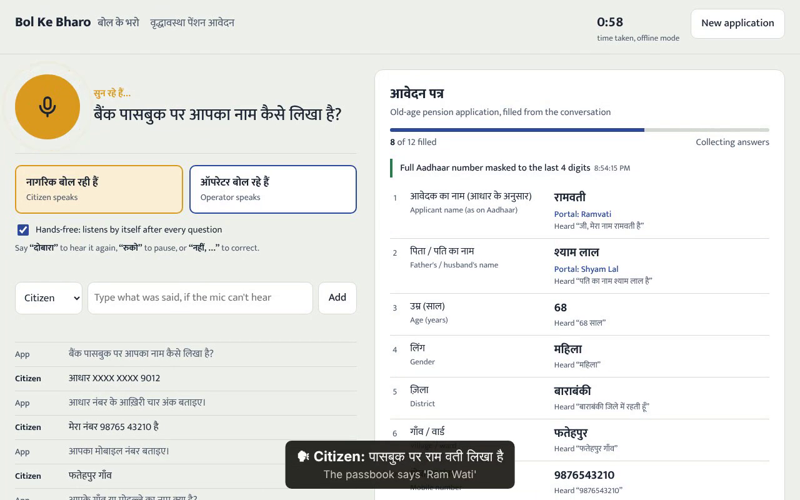

# Bol Ke Bharo — बोल के भरो

A voice co-pilot for people who fill forms for others (CSC operators, bank mitras, ASHA workers).
The operator and the citizen talk naturally in Hindi or Hinglish. The form fills itself, the
rejection guard catches mistakes, and everything is read back to the citizen for a spoken "हाँ".

> Independent assistant, not a government service. Audio is never stored, Aadhaar is masked to
> the last 4 digits, OTPs are never handled, and a person always does the final submit.



**Demo video:** [`demo/bol-ke-bharo-demo.mp4`](demo/bol-ke-bharo-demo.mp4) (automated walkthrough, captions in Hindi and English).

## Why it scores where it matters

| Criterion | What Bol Ke Bharo does |
|---|---|
| **Voice-first experience** | Hands-free: after every spoken question it listens automatically. Silence gets a quiet retry, then a re-ask, then a pause. Voice commands: “दोबारा” (repeat), “रुको” (pause). Numbers are read back digit by digit. Nobody types. |
| **India relevance** | Built for the ~5.67 lakh Common Service Centres (MeitY, Oct 2025) where operators fill pension forms for citizens who can't. Works in Devanagari Hindi and Hinglish, understands “तीस हजार” and “अड़सठ साल”, masks Aadhaar. |
| **Working product** | Full pension application by voice, end to end, tested: 11 unit tests plus a browser test that completes a whole application with zero taps. Runs with no API key (offline extractor) or with Claude for free-form conversation. |
| **Originality** | Not a chatbot that answers questions: it listens to a **two-person** conversation, fills a real form, and **catches rejection causes** at the counter. Its name matcher knows रामवती and Ramvati are the same name in two scripts, but Ramvati and Ram Wati will be rejected by a portal, and Ramvati vs Sunita may be the wrong bank account. Then it gets spoken consent before export. |

## Status

| Layer | State |
|---|---|
| L1 Conversation → form | ✅ Claude extractor (structured output) + offline slot-filling extractor for Hindi/Hinglish |
| L2 Rejection guard + read-back + "हाँ" consent | ✅ cross-script name matching (`backend/names.py`: Devanagari → portal spelling, sound-alike keys), minimum age, age proof |
| Voice loop | ✅ Hands-free turn-taking, no-input retry ladder, voice commands (“दोबारा”, “रुको”, “गाँव बदलो”), on-screen event labels |
| Speech | Browser Web Speech API (`hi-IN`) for listening and speaking. Sarvam / Bhashini are the next step. |
| L3 Portal autofill | ✅ Practice portal fills itself (`web/portal.html`); Chrome extension in `extension/` fills the open portal tab. Never touches captcha, OTP or submit. |
| Languages | ✅ Hindi / Hinglish and Tamil (questions, read-back, voice commands, Tamil name romanisation) |
| Forms | ✅ Old-age pension and widow pension, each one JSON file in `schemas/` |

## Measured results

Offline engine (no API key) on scripted conversations. **These are synthetic, written by the team, not real recordings**, and the tuned sets flatter the engine. Held-out set 2 is the fair number. Real speech will score lower.

| Conversations | n | Fields correct | Name mismatches caught | False alarms | Completed to “हाँ” |
|---|---|---|---|---|---|
| Hindi (Devanagari) | 16 | 100.0% | 6/6 | 0 | 100% |
| Hinglish (Latin script) | 12 | 100.0% | 6/6 | 0 | 100% |
| Tamil | 12 | 100.0% | 3/3 | 0 | 100% |
| All tuned sets | 40 | 100.0% | 15/15 | 0 | 100% |
| Held-out set 1 (Hindi, used once to find a gap) | 16 | 100.0% | 6/6 | 0 | 100% |
| Held-out set 2 (Hindi, used once to find a gap) | 16 | 100.0% | 6/6 | 0 | 100% |
| **Held-out set 3 (Hindi + Tamil, never used for tuning)** | 20 | 41.7% | 0/2 | 10 | 0% |

Offline engine, 0.1 ms per turn on this machine. Held-out set 3 fields most often wrong: bank_account_name (20), has_age_proof (20), district (20), village (20), annual_income (20), gender (10), guardian_name (10), aadhaar_last4 (10), name (10).

**What this means.** The offline extractor is a word-list fallback: it is near-perfect on phrasings like the ones it was built from, but on held-out set 3 (chatty Hindi, mixed English like "last four", and colloquial Tamil like "வயசு", "ஊரு", "பாஸ்புக்ல") it gets 41.7% of fields. It fails *safely*: wrong or missing values trigger a re-ask, a name-mismatch question, or a correction at the read-back, and nothing reaches the portal without the citizen's spoken "हाँ". Free-form speech is the job of the Claude extractor (`BKB_EXTRACTOR=claude`, needs `ANTHROPIC_API_KEY`), which falls back to the offline rules if the API is unreachable. Its accuracy on the same sets has not been measured yet.

```bash
python -m eval.run_eval
```

## Known limitations

- Chrome's speech recognition sends audio to Google to transcribe it. Bol Ke Bharo itself stores no audio.
- The offline extractor answers one question at a time; free-form, multi-field speech needs the Claude extractor.
- The pension form fields and rules are a demo and must be checked against the real portal.
- No barge-in: the app does not listen while it is speaking, to avoid hearing itself on laptop speakers.

## Run

```bash
pip install -r requirements.txt
export ANTHROPIC_API_KEY=...        # optional; without it the offline rule extractor is used
python -m uvicorn backend.app:app --port 8000
```

Open http://localhost:8000 in **Chrome** (it has Hindi speech recognition). Tap **Operator** or
**Citizen** before each person speaks, or type into the box.

```bash
python -m pytest -q                      # unit tests
node tests/e2e/handsfree.js              # browser test: full application, zero taps (server must be running)
node demo/make_video.js demo/            # re-record the demo video
```

Settings: `BKB_MODEL` (default `claude-sonnet-5-5`), `BKB_EXTRACTOR=rules` to force offline mode.

## How it works

```
mic (browser, hi-IN) ──text──► POST /turn ──► mask Aadhaar ──► extractor (Claude) ──► fields + confidence
                                                                          │
              speak (browser TTS) ◄── next question ◄── dialog ◄── guard (schema rules)
```

Dialog priority each turn: (1) a rejection risk not yet asked about, (2) the next missing field,
(3) a low-confidence value to confirm, (4) a full read-back that needs a spoken "हाँ".
Any change after the read-back requires a new read-back. `/export` is refused until the citizen confirms.

## Design

The UI follows Anthropic's open-source `frontend-design` skill: one typeface built for Hindi and English (Mukta, by Indian foundry Ek Type), colours taken from the CSC counter (form paper, ink, rubber-stamp indigo, haldi for "listening", sindoor for rejection risk), one bold element (the voice orb next to the current question), and a form laid out like the printed one it replaces. Works on phones and in dark mode.

## Adding a form

Every form is one JSON file in `schemas/`: fields (type, pattern, Hindi question and read-back)
and rules (`min`, `must_be_true`, `name_match`). Rules are data, never code.
`schemas/pension_up.json` is a **demo**: check its fields and rules against the real portal and
CSC operators before relying on it.

## Credits

FastAPI, Pydantic, the Anthropic Python SDK, and the browser Web Speech API.
